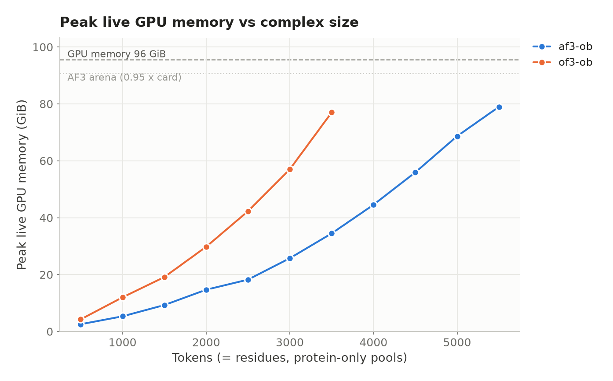
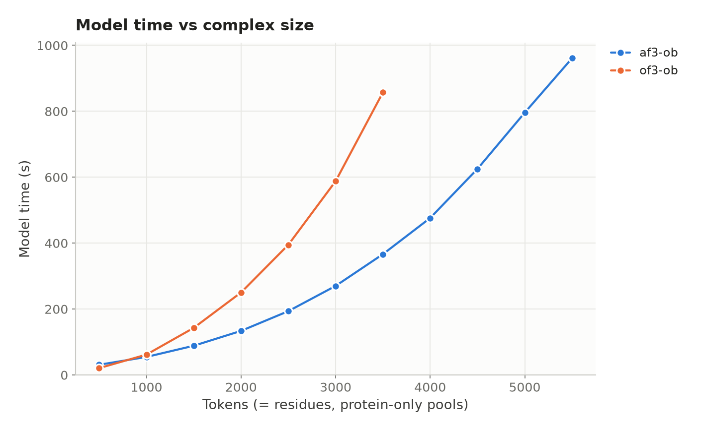
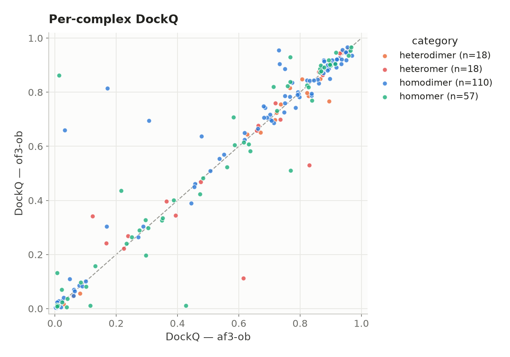
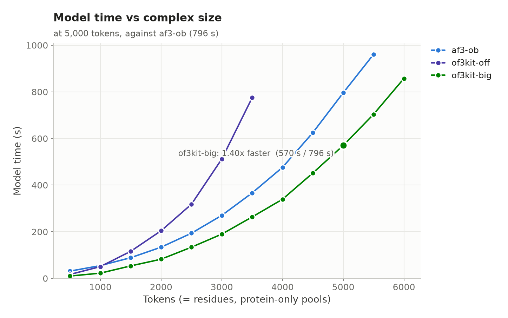
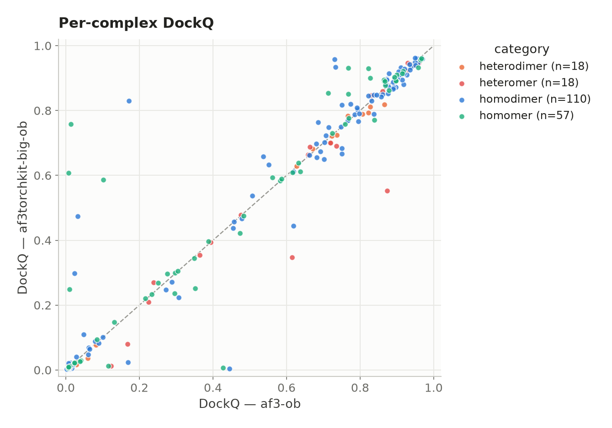

# Running OpenFold3 weights with the AlphaFold 3 codebase

## In a nutshell

This runs OpenFold3's weights with the AlphaFold 3 codebase. The weights are the same
either way, so accuracy should match OpenFold3's own codebase. It did on the one
benchmark tested here; broader tests are needed ([Limitations](#limitations)). On one
RTX Pro 6000 the AlphaFold 3 code fits 5500 residues instead of 3500, and at 3500 it
uses less than half the memory and runs about twice as fast. Both the code and the
weights are Apache 2.0, so no access request is needed.

We also tried Anthropic's inference optimization kits on the same weights; that is its own
section, [Anthropic's optimization kits](#anthropics-optimization-kits).

This repository is only the evaluation scripts. The weight port itself lives in
[juliabuhmann/alphafold3](https://github.com/juliabuhmann/alphafold3), branch
`add_openbind_porter`.

## Overview

Accompanying scripts for benchmarking the AlphaFold 3 codebase driven with
**OpenFold3 weights** instead of DeepMind's.

The motivation is licensing. AlphaFold 3's *source code* is permissively licensed,
but its *model parameters* are not: they require an access request and are limited
to non-commercial use. OpenFold3 is an open reproduction whose weights carry no such
restriction.

The substitution is possible because OpenFold3 set out to be
["a bitwise reproduction of DeepMind's AlphaFold3"](https://github.com/aqlaboratory/openfold-3)
rather than a new architecture. These scripts check that the substitution does not
break anything — that the AlphaFold 3 codebase on OpenFold3's weights predicts what
OpenFold3's own codebase predicts — and measure what it buys in memory and speed.

| component | licence |
|---|---|
| [AlphaFold 3 source code](https://github.com/google-deepmind/alphafold3/blob/main/LICENSE) | Apache 2.0 |
| [AlphaFold 3 model parameters](https://github.com/google-deepmind/alphafold3/blob/main/WEIGHTS_TERMS_OF_USE.md) | AlphaFold 3 Model Parameters Terms of Use — access request required, non-commercial only |
| [OpenFold3 code](https://github.com/aqlaboratory/openfold-3/blob/main/LICENSE) | [Apache 2.0](https://www.apache.org/licenses/LICENSE-2.0) |
| [OpenFold3 weights](https://huggingface.co/OpenFold/OpenFold3) (`of3-ob-2025-06-30-174k`) | Apache 2.0 — academic and commercial, no access request |

**AlphaFold 3 code plus OpenFold3 weights is therefore Apache 2.0 end to end**, and
that is the licence for the scripts in this repository. Running the OpenFold3 arm
needs no DeepMind parameters, and none are redistributed here.

One arm in the published tables, `af3_native`, does use the DeepMind parameters, and
those stay under their own Terms of Use — as do structures predicted with them. That
applies to that arm alone; nothing shown below depends on it.

## Why not just run OpenFold3?

The OpenFold3 weights work with the OpenFold3 codebase too (obviously), but AlphaFold 3's
implementation is less GPU-memory hungry and so fits larger complexes on the same
card: tested in-house on an RTX Pro 6000 (96 GB), OpenFold3 topped out at 3500
residues while the AlphaFold 3 codebase reached 5500 on the same hardware, and
it is the faster of the two from ~1500 residues up (see
[Runtime and memory](#runtime-and-memory)).

## Getting the code

The weight-loading support lives in this fork of AlphaFold 3:

**https://github.com/juliabuhmann/alphafold3** — branch `add_openbind_porter`

itself a fork of [sokrypton/alphafold3](https://github.com/sokrypton/alphafold3).

It converts the OpenFold3 PyTorch checkpoint into AlphaFold 3's parameter layout
(`convert_of3_weights.py`) and adds an `--of3_weights` flag to `run_alphafold.py`.
CI publishes a container with the converted weights already inside at `/models`, so
the OpenFold3 arm needs nothing but the image:

```
ghcr.io/juliabuhmann/alphafold3:openbind-1fff5c4
```

This repository is the harness around it — dataset prep, SLURM submission, DockQ
scoring, plots. Start at [`run_workflow.sh`](run_workflow.sh); the two arms compared
below are [`configs/af3_openbind_templateoff.json`](configs/af3_openbind_templateoff.json)
and [`configs/of3_openbind_templateoff.json`](configs/of3_openbind_templateoff.json).

## What was tested

### Runtime and memory

Each codebase was walked up a 500-to-7000-token grid in 500-token steps on one RTX Pro
6000, over pools of *n* copies of one real 250-aa chain with its own MSAs; the curves
end at the largest pool that ran. Memory is the framework's own live-buffer peak (JAX
`peak_bytes_in_use`, PyTorch `max_memory_allocated`), not `nvidia-smi`, which cannot
see inside AlphaFold 3's preallocated XLA arena. That arena is the AlphaFold 3
ceiling, and the sweep sizes it with `XLA_CLIENT_MEM_FRACTION=0.95` (~91 GiB) as the
weight-porting runs do, so 5500 residues is the number for that setting; at JAX's
default fraction of 0.75 (~72 GiB), which is what [`slurm/predict.sbatch`](slurm/)
leaves in place, the largest pool that fits is 5000. Model time is each engine's own timer
(AlphaFold 3's log, OpenFold3's `timing.json`), excluding startup and parameter
loading; details in [`profiling/`](profiling/).




### Performance

Whether the substitution breaks anything, at fixed weights: the AlphaFold 3 codebase
against OpenFold3's own, on identical inputs.

#### Dataset

**Benchmark-IV** from Zheng & Peng (2025), *A Comprehensive Benchmarking of
AlphaFold3 for Predicting Biomacromolecules and Their Interactions*, Briefings in
Bioinformatics ([bbaf616](https://doi.org/10.1093/bib/bbaf616)), taken from the
paper's own release, [Zenodo 15502855](https://zenodo.org/records/15502855).

The paper selected structures released after 1 January 2024; the 203 targets used here
were first released in the PDB between 2024-01-03 and 2024-05-22. That is after AlphaFold 3's
training cutoff (30 September 2021) but more than a year before openbind's — the
[OpenBind-0 announcement](https://openbind.uk/news/blog-openbind-0-advancing-open-molecular-structure-prediction/)
states it is "trained on data from the Protein Data Bank (PDB) through June 2025". So the set is
held out for *AlphaFold 3* but not for openbind, and the absolute DockQ values below are not
held-out accuracy. To recheck the dates against the live PDB:

```bash
pixi run python scripts/10_pdb_release_stats.py entries \
    --tsv results/benchmark/sweep/af3-ob_of3-ob/complexes_evaluated.tsv
```

Both configurations run the same weights, so the comparison between them is unaffected.

#### Setup

203 of the 206 complexes were predicted with each codebase on the same openbind
weights, everything else held fixed: same precomputed MSAs, no templates either side,
3 recycles, 5 diffusion samples, seed 42, same GPU type. Scored with DockQ v2 at
default settings, as in the paper. Each point is one complex:



Per-complex values, per-interface metrics and inference times are in
[`results/dockq.tsv`](results/dockq.tsv) and
[`results/profiling.tsv`](results/profiling.tsv), where the `run` column names the arm:
the two above, plus the templates-on pair on either weight set (`af3_openbind`,
`af3_native`) and the paper's own predictions (`zheng_af3_local`).

### Where the figures are

Every figure is written by a script into a directory named after the comparison it
shows, so a figure is never separated from the numbers behind it:

    results/<experiment>/sweep/<short1>_<short2>_.../  several arms compared
    results/<experiment>/individual_runs/<short>/     one arm on its own

`<experiment>` is `benchmark` (DockQ and model time per complex, Benchmark-IV) or
`scaling` (peak memory and model time against token count, on the pool ladder).
Every arm config carries a `short` -- `af3-ob`, `of3kit-big`, `af3-ob-a100` -- and that is
the arm's name on the command line, in the legend and in the path, so a figure and its
location always agree. A comparison is named after the arms it holds, in the order given,
and the first arm is the baseline. Each directory also holds `metrics.tsv` and a
`manifest.json` recording which config each short resolved to, the source tables and the
commit that drew them. Colours come from
[`configs/arm_style.json`](configs/arm_style.json), keyed by the same short. To redraw:

```bash
pixi run plot-benchmark --arms af3-ob of3-ob --dockq $AF3OF3_BASE_DIR/results/dockq \
                                             --profile $AF3OF3_BASE_DIR/results/profiling
pixi run plot-scaling   --arms af3-ob of3kit-big --speedup-at 5000
pixi run plot-scaling   --arms          # list the arms and what each one is
```

### How do AlphaFold 3's own weights compare to openbind?

To the extent that this pipeline and OpenFold3's own codebase produce the same
structures from the same weights — which the comparison above supports on average —
every benchmark published on the openbind weights carries over to this setup, and
those are the numbers to read for what these weights can do: the
[OpenFold3 preprint](https://www.biorxiv.org/content/10.64898/2026.08.27.747600v1.full.pdf)
on openbind's precursor, and the more extensively evaluated preview-2 release in its
[technical report](https://portal.openfold.io/reports/of3p2_technical_report.pdf).

Empirically, what this repository cannot tell you is what the substitution costs
against AlphaFold 3's own weights: Benchmark-IV is held out for AlphaFold 3, but every
target predates openbind's June 2025 cutoff, so a comparison here flatters openbind.
That needs an analysis on a  benchmark released after the cutoff.

### Limitations

What this benchmark does and does not cover:

- **Protein–protein interfaces only.** Benchmark-IV multimers are protein-only, so
  nothing here speaks to nucleic acids, ligands or covalent modifications — a large
  part of what AlphaFold 3 is used for.
- **No real held-out test.** Every target predates openbind's June 2025 training
  cutoff, so a held-out answer needs a benchmark released after it.
- **One seed.** Five diffusion samples from seed 42, best-ranked sample scored.
  Seed-to-seed variation is uncharacterised, so small per-complex differences may be
  sampling noise.
- **3 recycles, not AlphaFold 3's default of 10.** Matched across every configuration,
  so the comparison between them is unaffected, but absolute values are not on the
  same footing as a default-parameter run such as the paper's.
- **Templates off.** The comparison shown runs without templates on either side.
- **Multi-chain DockQ is an interface mean.** Above two chains, DockQ v2 averages
  over native interfaces, which can mask one badly modelled interface;
  `dockq_min_interface` in the results table exposes the worst one.

## Anthropic's optimization kits

Anthropic released [optimization kits](https://github.com/anthropics/uplifting-biomolecular-modeling)
that make open structure-prediction codebases faster or lighter on GPU memory. You pick a mode:
`off` (stock), `exact`, `fast`, or `big` (lowest memory). We tried two kits on the openbind weights
and the RTX PRO 6000:

| kit | what it runs | source | image |
|---|---|---|---|
| `af3_torch` | xfold, a PyTorch port of AlphaFold 3 | our fork [juliabuhmann/uplifting-biomolecular-modeling](https://github.com/juliabuhmann/uplifting-biomolecular-modeling), branch `add-af3torch-openbind-porter`, commit `6737cbf` | `ghcr.io/juliabuhmann/af3_torch-kit:6737cbf` |
| `openfold3_ob0` | OpenFold3 | Anthropic's release, unchanged, commit `f4f62fa` | none, installed locally |

Our fork adds what `af3_torch` needs to load the openbind weights, plus a fix for the RTX PRO 6000.

Neither kit officially supports this card, so both needed tweaks and some of their kernels fall back
to slower code. Which kit and mode pays off depends on your GPU and the size of your typical input,
so it is worth measuring on your own hardware rather than taking the numbers below as general.

### Results

**`openfold3_ob0` fits larger complexes and runs faster.** In mode `big` it reaches 6000 tokens,
against 3500 for stock OpenFold3 and 5500 for the AlphaFold 3 codebase, and at 5000 tokens it is
1.4x faster than the AlphaFold 3 codebase.



**`af3_torch` matches the AlphaFold 3 codebase's accuracy but was slower on this card.** On the
203 Benchmark-IV complexes, with the same precomputed MSAs and settings, median DockQ is 0.667
against 0.671; median model time is 150 s against 69 s. Each point is one complex:



As with the main benchmark, every target predates openbind's training cutoff
([Dataset](#dataset)), so this shows that the two codebases agree, not how well either predicts
unseen complexes.

### Using `af3_torch` yourself

Build the image with the fork's `kit image` GitHub Action (branch `add-af3torch-openbind-porter`,
kit `af3_torch`), then convert it on the cluster:

```bash
apptainer build af3_torch-kit_obporter.sif docker://ghcr.io/juliabuhmann/af3_torch-kit:6737cbf
```

Convert the openbind weights once into an empty directory:

```bash
singularity exec --nv --cleanenv --pwd /kit/af3_torch --bind $WEIGHTS:$WEIGHTS \
    af3_torch-kit_obporter.sif bash run.sh install --weights $WEIGHTS --fetch --variant ob
```

Predict from an AlphaFold 3 input JSON that already contains its MSAs:

```bash
singularity exec --nv --cleanenv --pwd /kit/af3_torch \
    --bind $WEIGHTS:$WEIGHTS:ro --bind $PWD:$PWD --env AF3_TORCH_PARAMS_DIR=$WEIGHTS \
    af3_torch-kit_obporter.sif bash run.sh pred --config h100 --mode big --allow-partial \
    --json_path=$PWD/input.json --output_dir=$PWD/out --model_dir=$WEIGHTS --norun_data_pipeline
```

Set `--config` to your card (`a100`, `h100` or `h200`). Our run's configuration is
[`configs/af3torchkit_big_ob_templateoff.json`](configs/af3torchkit_big_ob_templateoff.json);
the `openfold3_ob0` setup is described in [`profiling/README.md`](profiling/README.md).

## Credits

[juliabuhmann/alphafold3](https://github.com/juliabuhmann/alphafold3), the fork the
image here is built from, is itself a fork of
[sokrypton/alphafold3](https://github.com/sokrypton/alphafold3). The weights come
from the [OpenFold consortium](https://github.com/aqlaboratory/openfold-3). Thanks to
Jürgen Jänes for support along the way. This work was carried out in the
[Beltrao lab](https://beltraolab.com/) at ETH Zurich.

The code in this repository was written by Claude, supervised by Julia Buhmann.