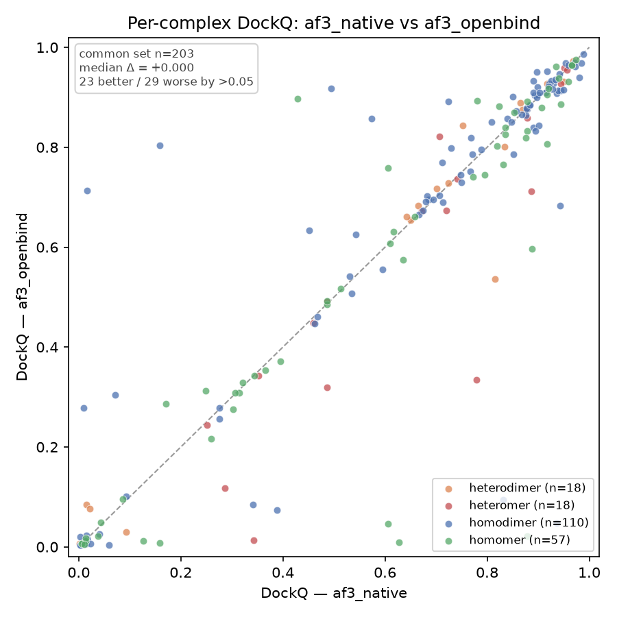

# Running OpenFold3 weights with the AlphaFold 3 codebase

Accompanying scripts for benchmarking the AlphaFold 3 codebase driven with
**OpenFold3 weights** instead of DeepMind's.

The motivation is licensing. AlphaFold 3's *source code* is permissively licensed,
but its *model parameters* are not: they require an access request and are limited
to non-commercial use. OpenFold3 is an open reproduction whose weights carry no such
restriction.

The substitution is possible because OpenFold3 set out to be
["a bitwise reproduction of DeepMind's AlphaFold3"](https://github.com/aqlaboratory/openfold-3)
rather than a new architecture. These scripts measure what that substitution does on a
published protein-complex benchmark.

| component | licence |
|---|---|
| [AlphaFold 3 source code](https://github.com/google-deepmind/alphafold3/blob/main/LICENSE) | Apache 2.0 |
| [AlphaFold 3 model parameters](https://github.com/google-deepmind/alphafold3/blob/main/WEIGHTS_TERMS_OF_USE.md) | AlphaFold 3 Model Parameters Terms of Use — access request required, non-commercial only |
| [OpenFold3 code](https://github.com/aqlaboratory/openfold-3/blob/main/LICENSE) | [Apache 2.0](https://www.apache.org/licenses/LICENSE-2.0) |
| [OpenFold3 weights](https://huggingface.co/OpenFold/OpenFold3) (`of3-ob-2025-06-30-174k`) | Apache 2.0 — academic and commercial, no access request |

**AlphaFold 3 code plus OpenFold3 weights is therefore Apache 2.0 end to end**, and
that is the licence for the scripts in this repository. Running the OpenFold3 arm
needs no DeepMind parameters, and none are redistributed here.

The reference arm in the comparison does use the DeepMind parameters, and those stay
under their own Terms of Use — as do structures predicted with them. That applies
only to the reference arm.

## Why not just run OpenFold3?

The OpenFold3 weights work with the OpenFold3 codebase too (obviously), but AlphaFold 3's
implementation is less GPU-memory hungry and so fits larger complexes on the same
card: tested in-house on an RTX Pro 6000 (90 GB), OpenFold3 topped out at around
3500 residues while the AlphaFold 3 codebase reached ~5000 on the same hardware.

## Getting the code

The weight-loading support lives in this fork of AlphaFold 3:

**https://github.com/juliabuhmann/alphafold3** — branch `add_openbind_porter`

itself a fork of [sokrypton/alphafold3](https://github.com/sokrypton/alphafold3).

It converts the OpenFold3 PyTorch checkpoint into AlphaFold 3's parameter layout
(`convert_of3_weights.py`) and adds an `--of3_weights` flag to `run_alphafold.py`.
CI publishes a container with the converted weights already inside at `/models`, so
the OpenFold3 arm needs nothing but the image:

```
ghcr.io/juliabuhmann/alphafold3:openbind-1fff5c4
```

This repository is the harness around it — dataset prep, SLURM submission, DockQ
scoring, plots. Start at [`run_workflow.sh`](run_workflow.sh); the two arms are
[`configs/af3_native.json`](configs/af3_native.json) and
[`configs/af3_openbind.json`](configs/af3_openbind.json).

## What was tested

**Benchmark-IV** from Zheng & Peng (2025), *A Comprehensive Benchmarking of
AlphaFold3 for Predicting Biomacromolecules and Their Interactions*, Briefings in
Bioinformatics ([bbaf616](https://doi.org/10.1093/bib/bbaf616)): 206 protein
multimers released after 2024-01-01, ≤40% sequence similarity to AlphaFold 3's
training set, one per structural cluster. Data comes from the paper's own release,
[Zenodo 15502855](https://zenodo.org/records/15502855), including the
`cleanNative.pdb` structures it scores against.

203 of the 206 complexes were predicted twice, once per weight set, with everything
else held fixed: same container, same input JSONs carrying the same precomputed MSAs
and templates, same 3 recycles, 5 diffusion samples and seed. Interfaces were scored
with DockQ v2 at default settings — the same tool and settings the paper used.

Each point is one complex, DockQ from the AlphaFold 3 weights against DockQ from the
OpenFold3 weights:



Per-complex values, per-interface metrics and inference times are in
[`results/dockq.tsv`](results/) and [`results/profiling.tsv`](results/).


### Limitations

What this benchmark does and does not cover:

- **Protein–protein interfaces only.** Benchmark-IV multimers are protein-only, so
  nothing here speaks to nucleic acids, ligands or covalent modifications — a large
  part of what AlphaFold 3 is used for.
- **No significance test.** None was run, and per-category subsets (smallest n=18)
  are too small to carry claims on their own.
- **One seed.** Five diffusion samples from seed 42, best-ranked sample scored.
  Seed-to-seed variation is uncharacterised, so small per-complex differences may be
  sampling noise.
- **3 recycles, not AlphaFold 3's default of 10.** Matched across both arms, so the
  comparison between them is unaffected, but absolute values are not on the same
  footing as a default-parameter run such as the paper's.
- **Old templates.** Capped at 2021-09-30 (AlphaFold 3's default) while targets are
  post-2024 — no leakage, but less template information than a current run.
- **A preview checkpoint.** `of3-ob-2025-06-30-174k` is one intermediate OpenFold3
  release; later checkpoints may differ.
- **Multi-chain DockQ is an interface mean.** Above two chains, DockQ v2 averages
  over native interfaces, which can mask one badly modelled interface;
  `dockq_min_interface` in the results table exposes the worst one.
- **3 complexes missing.** `8iay`, `8jnw` and `8r6q` lacked precomputed MSAs, so all
  numbers are over 203 of 206.

## Credits

[juliabuhmann/alphafold3](https://github.com/juliabuhmann/alphafold3), the fork the
image here is built from, is itself a fork of
[sokrypton/alphafold3](https://github.com/sokrypton/alphafold3). The weights come
from the [OpenFold consortium](https://github.com/aqlaboratory/openfold-3). Thanks to
Jürgen Jänes for support along the way. This work was carried out in the
[Beltrao lab](https://beltraolab.com/) at ETH Zurich.
