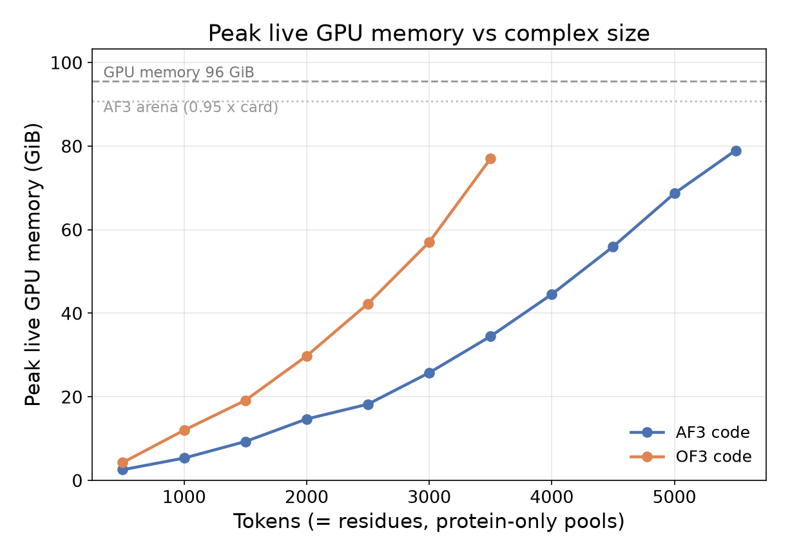

# VRAM scaling — how far up the token axis each codebase gets

The top-level README claims that on one RTX Pro 6000, "OpenFold3 topped out at around
3500 residues while the AlphaFold 3 codebase reached ~5000". This directory is the
measurement behind that sentence: peak GPU memory against token count for the two
arms that differ only in the codebase, walked upwards until one of them stops.

Both sweeps have been run to completion, on one RTX Pro 6000 (96 GiB) per arm, 5
diffusion samples, 3 recycles, seed 42, templates off in both.



*Each curve ends at the largest pool that ran; the next 500-token step ran out of GPU
memory. Templates are off in both arms.*

| | largest pool that ran | peak live memory there | first failure |
|---|---|---|---|
| AlphaFold 3 code | **5500 tokens** | 79.0 GiB | GPU OOM at 6000 (reached 87.6 GiB) |
| OpenFold3 code | **3500 tokens** | 77.0 GiB | GPU OOM at 4000 (reached 92.5 GiB) |

The AF3 codebase runs the same weights on a pool **2000 tokens larger** on the same
card, and needs roughly half the memory at matched size (3500 tokens: 34.5 GiB against
77.0 GiB). Its ceiling here is the XLA arena, 0.95 x the card; OpenFold3 allocates on
demand and stops against the card itself.

Per-size numbers, including the nvidia-smi trace and the allocator's reserved
high-water, are in `results/af3_openbind_templateoff.tsv` and
`results/of3_openbind_templateoff.tsv` (copied out of
`<base>/profiling/<arm>/vram_sweep.tsv` by the plotting script). `--runtime` adds the model
time panel (`results/vram_and_runtime.png`), where the two engines cross over between
1000 and 1500 tokens — OpenFold3 is faster below that and slower above it, which is the
same crossover the Benchmark-IV runtimes show.

## What is measured

One arm per sweep, taken from the repository's own arm configs, so the sweep runs the
configuration the benchmark ran and not a variant of it:

| arm | config | codebase | weights |
|---|---|---|---|
| `af3_openbind_templateoff` | [`configs/af3_openbind_templateoff.json`](../configs/af3_openbind_templateoff.json) | AlphaFold 3 | OpenFold3 openbind |
| `of3_openbind_templateoff` | [`configs/of3_openbind_templateoff.json`](../configs/of3_openbind_templateoff.json) | OpenFold3 | OpenFold3 openbind |

Both templates-off, which is the pair the repository already treats as the like-for-like
code comparison: the OF3 converter carries no templates over, so the AF3 side has to
run without them too. Passing `configs/af3_openbind.json` instead sweeps the
templates-ON variant, and the difference between the two is the template memory cost.

## The inputs

`build_pool_inputs.py` builds one pool per token count: *n* copies of a single real
benchmark sequence, with that sequence's real MSAs and templates copied verbatim out of
`<base>/work/msa_store/`. Nothing is recomputed and nothing is synthetic — the monomer
is chosen by rule (shortest store sequence ≥ 150 aa whose length divides the 500-token
step), which on this dataset is a 250-aa chain with 1313 unpaired and 1274 paired
alignment rows, so every pool lands exactly on the 500-token grid.

The OF3 queries are then derived from those AF3 JSONs by the repository's own converter
([`scripts/09_build_of3_inputs.py`](../scripts/09_build_of3_inputs.py)), which is what
makes the two engines provably read the same alignments.

For protein-only inputs one standard residue is one token, so tokens == residues.

## Running it

```bash
export AF3OF3_BASE_DIR=/path/to/workdir/af3code_of3weights

# from a login node — one job per arm, each holding one GPU for the whole grid
bash profiling/run_sweep.sh --config configs/of3_openbind_templateoff.json --time 12:00:00
bash profiling/run_sweep.sh --config configs/af3_openbind_templateoff.json --time 12:00:00

# or inside an allocation that already has a GPU to itself
bash profiling/run_sweep.sh --config configs/of3_openbind_templateoff.json --local
```

The first invocation builds the pool inputs if they are missing. Add `--dry-run` to see
the `sbatch` line without submitting, `--max-tokens N` to stop the grid early, and
`--end`/`--step` to change the grid that gets built.

Each job appends one row per size to `<base>/profiling/<arm>/vram_sweep.tsv` as it
finishes, and stops at the first size that fails. A re-submission skips sizes already
in that table, so a job that runs out of wall clock is resumed by submitting it again.

Then plot (matplotlib comes from the pixi environment):

```bash
pixi run python profiling/plot_vram.py --out profiling/results/vram_vs_tokens.png
pixi run python profiling/plot_vram.py --runtime --out profiling/results/vram_and_runtime.png
```

`plot_vram.py` picks up every `<arm>/vram_sweep.tsv` under `$AF3OF3_BASE_DIR/profiling`
(override with `--sweep-dir`, restrict and order with `--arms`), prints the per-size
table it plotted, and takes `--metric peak_vram_gib` to plot the nvidia-smi trace
instead of the default live-buffer high-water.

## A third way to launch the OF3 engine: Anthropic's optimization kit

Anthropic's [uplifting-biomolecular-modeling](https://github.com/anthropics/uplifting-biomolecular-modeling)
release (Apache-2.0, 2026-09-17, explicitly unmaintained) ships `openfold3_ob0`: OpenFold3 0.5.0 with
the OpenBind-0 checkpoint — the same code family and the very same weights as the `of3` arm — plus
drop-in optimization modes: `off` (stock, as the kit defines it), `exact` (outputs identical to stock)
`fast` (within stock's seed-to-seed variation) and `big` (lowest peak GPU memory, numerics as fast). Four arms run it through this sweep:

| arm | config | what runs |
|---|---|---|
| `of3kit_off_templateoff` | [`configs/of3kit_off_templateoff.json`](../configs/of3kit_off_templateoff.json) | upstream's entry point on the kit's stock yaml — the denominator |
| `of3kit_exact_templateoff` | [`configs/of3kit_exact_templateoff.json`](../configs/of3kit_exact_templateoff.json) | `pred --mode exact` |
| `of3kit_fast_templateoff` | [`configs/of3kit_fast_templateoff.json`](../configs/of3kit_fast_templateoff.json) | `pred --mode fast` |
| `of3kit_big_templateoff` | [`configs/of3kit_big_templateoff.json`](../configs/of3kit_big_templateoff.json) | `pred --mode big` — lowest peak memory; below the kit's 1,401-token gate it is the fast line |

The kit is **not vendored**. A config's `launcher` block names a clone at a pinned commit, the venv,
the kit's per-card file to source, the mode and the levers to disable;
[`setup_kit_env.sh`](setup_kit_env.sh) builds every path the block names, following the kit's own
route C with the three host deviations it documents (DeepSpeed without its DS4Sci op, an `nvcc`
from conda for DeepSpeed's import-time probe, X11 client libraries from conda for RDKit). The engine
stays `of3`: same queries, same `torch.cuda.max_memory_allocated` counter, same `timing.json` model
time — only the launch differs, and `sweep.sbatch` picks it from the presence of the block.

Three things a reader of the numbers should know.

* **This card is outside the kit's tested set.** The kit ships card files for H100, A100, H200,
  B200 and B300; the RTX PRO 6000 (compute capability 12.0) has none, so `h100.env` is sourced for
  the environment bootstrap alone — the card files differ in one line, `MODEL_OPT_TARGET_GPU`, which
  only the untested `big` mode consumes. Kernel tables resolve from the real compute capability at
  run time; cc 12.0 has no tuned rows and gets the kit's safe settings, which the kit reports. One
  `fast` lever, the fused pair transition, refuses on this architecture and is disabled by name
  (`levers_off`). The `fast` speed-up here is therefore a lower bound on what the kit does on its
  own hardware.
* **Warm-up runs.** The kit compiles Triton kernels per tensor shape inside the timed loop, and
  stock's own Triton kernels autotune per shape; a cold `fast` at 500 tokens measured slower than
  cold stock. `warmup_runs: 1` (a config key, default 0, so no other arm changes) runs each size
  once untimed before the recorded run, for all three kit arms equally.
* **`off` is its own arm, not `of3_openbind_templateoff`.** The kit's stock yaml differs from
  [`configs/of3_runner.yml`](../configs/of3_runner.yml) (no `low_mem` preset, bf16-mixed stated,
  chunk size pinned with the tuner off), so a speed-up is only meaningful against
  [`configs/of3kit_stock_runner.yml`](../configs/of3kit_stock_runner.yml), which copies the kit's
  file with its provenance in the header.

Status (2026-09-21): the launch path is validated at 500 tokens — `exact` and `fast` through the
sweep itself, `off` by the identical command run by hand while a foreign process held the GPU;
`big` only dry-run (same path, different `--mode` word). **No sweep has been run**; the tables and
figures above do not include these arms. Submit as for any arm:

```bash
bash profiling/run_sweep.sh --config configs/of3kit_off_templateoff.json   --time 12:00:00
bash profiling/run_sweep.sh --config configs/of3kit_exact_templateoff.json --time 12:00:00
bash profiling/run_sweep.sh --config configs/of3kit_fast_templateoff.json  --time 12:00:00
bash profiling/run_sweep.sh --config configs/of3kit_big_templateoff.json   --time 12:00:00
```

Also new for every OF3 arm: a failed size keeps OpenFold3's own `logs/predict_err_rank0.log` next to
its trace (`<arm>/pool_<N>aa/of3_logs/`). Upstream labels every caught exception "OOM for query_id",
and the traceback behind that line lives only there.

## Anthropic's kit on the AlphaFold 3 codebase: the `af3kit_*` arms (A100)

The same release also ships `af3_jax`, an optimization kit for the AlphaFold 3 JAX codebase itself,
pinned to the same upstream commit our fork branches from (sokrypton/alphafold3 v3.1.4) and to the
OpenFold3 **preview-2** weights. Four arms run it, beside the production engine on the same card:

| arm | config | what runs |
|---|---|---|
| `af3_openbind_templateoff_a100` | [`configs/af3_openbind_templateoff_a100.json`](../configs/af3_openbind_templateoff_a100.json) | the production image (openbind weights) on the A100 — the card baseline |
| `af3kit_off_p2_templateoff_a100` | [`configs/af3kit_off_p2_templateoff_a100.json`](../configs/af3kit_off_p2_templateoff_a100.json) | the kit's stock route: the fork's `run_alphafold.py`, no lever |
| `af3kit_exact_p2_templateoff_a100` | [`configs/af3kit_exact_p2_templateoff_a100.json`](../configs/af3kit_exact_p2_templateoff_a100.json) | `pred --mode exact` |
| `af3kit_fast_p2_templateoff_a100` | [`configs/af3kit_fast_p2_templateoff_a100.json`](../configs/af3kit_fast_p2_templateoff_a100.json) | `pred --mode fast` (the kit's default) |
| `af3kit_big_p2_templateoff_a100` | [`configs/af3kit_big_p2_templateoff_a100.json`](../configs/af3kit_big_p2_templateoff_a100.json) | `pred --mode big` — lowest peak memory |

`engine` stays `af3`: same `af3_pool` inputs, same AlphaFold 3 log timers for `model_s`. The
`launcher` block selects the kit's venv, card file, variant and mode;
[`setup_af3kit_env.sh`](setup_af3kit_env.sh) builds every path it names and fetches + converts the
preview-2 weights through the kit's own installer (digest-checked; the run's `WEIGHTS` line reads
`pinned`). The kit is not vendored: the clone is pinned by `kit_commit`.

**Not yet run.** Every row above was assembled and dry-run on 2026-09-21; no sweep has completed.
Numbers that exist so far come from single pairs on an A100 outside this harness (kit modes
`off`, `exact`, `fast` all produced structures; `fast` was 1.36x faster than `off` with four
inputs in one process and slower with one input per process; see the openbind notes below).

Things that shape how the rows must be read:

* **Peak memory comes from the kit's own line.** A kit mode runs the model in a child process
  that `peak_mem.py` cannot wrap. The kit prints `PEAK-NOTE ... peak_alloc_gib=` from its own
  hook — `jax peak_bytes_in_use`, the same counter `peak_mem.py` reads — and
  `run_with_trace.py` takes `peak_alloc_mib` from it when no `peak_mem.json` was written
  (`peak_alloc_source` in `results.json` says which).
* **`off` here is not the kit's own `off`.** The kit's stock route runs with an empty
  `--cache_dir` by design (fresh compile cache per pass, no tokamax autotune table). The sweep
  passes one node-local cache to every arm and size, as it does for the production image, so the
  kit arms are comparable to each other and to `af3_openbind_templateoff_a100`.
* **A per-process cost only kit modes pay.** Each kit mode attempts tokamax autotuning once per
  process (~20 s by the kit's README; it fails on this jax/tokamax pair and is memoised). One size
  per process here, so it lands inside `model_s`: large against a 500-token pool, under 3 % at
  5,000. The kit's intended shape is many inputs per process; batch-infer runs pools that way.
* **`fast` has a memory ceiling of its own.** Its diffusion-hoist lever keeps 24 per-block pair
  tensors resident (the kit's comments: +6.4 GiB at 3,072 tokens, ~+11 GiB at 4,096), and the kit
  puts `fast`'s limit near 3,072 tokens on an 80 GB card. Above that `big` is the mode, and `big`
  switches several of `fast`'s levers off by construction. Where `fast` stops is a result.
* **What the kit itself reports.** No end-to-end mode-vs-stock speed-up at any size. Its only
  quantitative statements are per-lever savings at 2,048 / 3,072 tokens on one H100 (fused
  triangle attention 18 / 43 s per input, fused triangle multiplication 6 / 14 s), and its kernel
  tables are measured to 1,536 tokens. This sweep is the first measurement above that.
* **Card.** The kit ships an `a100` card file; its headline is H100. On A100 the kit's README says
  `big` leaves the fused triangle attention and fused transition off.
* **OpenBind on this kit** needs four one-line changes ([`patches/af3_jax_openbind.diff`](patches/af3_jax_openbind.diff),
  applied to the clone by the setup script, gated on `of3_openbind`, inert for preview-2): the
  kit's vendored `run_alphafold.py` had no openbind switch, and three levers assume preview-2's
  pair-bias axes or per-block pair LayerNorm. Verified on the A100 on one pair: patched `exact` and
  `fast` reproduce stock's ipTM within 0.01 / 0.03; unpatched, `fast` stops on a missing
  `pair_input_layer_norm` parameter (loud) and the bias site would be wrong silently. The arms
  above run preview-2 on purpose, so the kit is measured as shipped first.

```bash
export AF3OF3_BASE_DIR=/path/to/workdir/af3code_of3weights
AF3OF3_KIT_ROOT=/path/to/anthropic_kits bash profiling/setup_af3kit_env.sh   # once

for arm in af3_openbind_templateoff_a100 af3kit_off_p2_templateoff_a100 \
           af3kit_exact_p2_templateoff_a100 af3kit_fast_p2_templateoff_a100 af3kit_big_p2_templateoff_a100; do
    bash profiling/run_sweep.sh --config configs/$arm.json --time 4:00:00     # gpupr.4h: 4 h is the partition's limit
done
# A job that runs out of wall clock leaves every finished size in <arm>/vram_sweep.tsv; submitting
# the same line again resumes at the first size not yet recorded.
pixi run python profiling/plot_vram.py --runtime --arms af3_openbind_templateoff_a100 af3kit_off_p2_templateoff_a100 af3kit_exact_p2_templateoff_a100 af3kit_fast_p2_templateoff_a100 af3kit_big_p2_templateoff_a100 --out profiling/results/a100_kit.png
```

## Two measurement traps

Both were hit on the first attempt, and both are why the numbers are collected the way
they are now.

**1. Turning off JAX preallocation moves the boundary.** `nvidia-smi` cannot see inside
a preallocated arena, so the obvious way to get a memory curve out of AlphaFold 3 is to
set `XLA_PYTHON_CLIENT_PREALLOCATE=false` and let the device reading follow demand. That
is wrong twice over: it caps the arena at JAX's default `0.75` fraction, and it leaves
BFC growing in separate regions, so a single large block cannot be placed in any of
them. Measured on the 4000-token pool:

| AF3 allocator env | 4000 tokens |
|---|---|
| `preallocate=false` (default 0.75 fraction) | OOM — could not allocate one 41.62 GiB block, device at 50.6 GiB |
| `preallocate=false`, `XLA_PYTHON_CLIENT_ALLOCATOR=platform` | OOM — same 41.62 GiB block |
| `preallocate=true`, `XLA_CLIENT_MEM_FRACTION=0.95` | ran, 476 s |

So the sweep uses the third row, which is what the openbind runs use
(`pooled_ppi_comparison/scripts/2026aug_af3_openbind_weights`). `MEM_FRACTION` changes
the fraction; `XLA_PYTHON_CLIENT_MEM_FRACTION` must be left alone, because jaxlib
refuses to start when both fraction variables are set.

**2. Under preallocation, `nvidia-smi` reports the arena, not the demand** — 93 GiB flat
at every size. So the curve comes from the frameworks' own counters instead
(`peak_mem.py`, which wraps the engine's entry point):

| column | what it is |
|---|---|
| `peak_alloc_mib` | live-buffer high-water: JAX `peak_bytes_in_use`, PyTorch `max_memory_allocated`. **The plotted curve** — the same quantity for both engines, independent of allocator policy |
| `peak_reserved_mib` | what the allocator held from the driver (AF3: the arena) |
| `peak_vram_mib` | `nvidia-smi` whole-device high-water, polled once a second |

The runtime panel's `model_s` is each engine's own timer, on the definition
`scripts/04_collect_profiling.py` uses — AF3's featurisation and inference log lines
summed, OF3's `runtime_s` from each seed's `timing.json` — and so excludes the
startup and parameter loading that `wall_s` includes.

The counters are read in a `finally` block, not an `atexit` hook: `atexit` runs
last-registered-first, so a hook registered before the engine imports its framework
runs *after* that framework has torn its backend down and reads zeroes. It did, first
time round.

`peak_vram_mib` is whole-device, so it also counts any other tenant of the same GPU —
the sweep is only meaningful with the card to itself. `gpu_total_mib` is in every row so
the ceiling is on the record.

`status` is not taken from the exit code alone: OpenFold3 exits 0 having failed every
query — it reports `OOM for query_id(s) ...` in its log and `Failed Queries: 1` in its
summary — and both engines print an out-of-memory before dying, so the log is read too.
`gpu_oom` is the boundary the sweep is looking for; `cpu_oom` (exit 137, the host OOM
killer) is not a GPU limit and is reported separately.

## Other things that change the answer

* **`TF_FORCE_UNIFIED_MEMORY` is deliberately left unset.** AlphaFold 3 recommends it
  above ~5120 tokens; it works by spilling to host RAM, which would turn the GPU
  boundary into a much slower run that never OOMs.
* **AlphaFold 3 pads token counts to buckets** (512, 1024, … 5120 by default), so its
  curve is a staircase and a 500-token pool is really a 512-token forward pass.
  OpenFold3 does not bucket.
* **The pools are homomeric.** A pool of one repeated sequence is not a biological
  complex and its predicted structure is meaningless — nothing here is scored. It is a
  token-count dial with a realistic feature payload behind it. Both engines expand the
  same entity *n* times, and the pool carries no cross-species pairing signal that a
  real heterocomplex would.
* **`num_diffusion_samples` is 5, from the arm configs.** Diffusion samples are batched,
  so peak memory depends on it; a sweep at 1 sample would reach further.

## Files

| file | what it does |
|---|---|
| `build_pool_inputs.py` | one AF3 input JSON per token count, from the MSA store |
| `run_sweep.sh` | read an arm config, build inputs if needed, submit or run the sweep |
| `sweep.sbatch` | hold one GPU, walk the grid upwards, stop at the first failure |
| `run_with_trace.py` | poll `nvidia-smi` around one prediction, classify the outcome |
| `peak_mem.py` | wrap the engine's entry point, record its own peak-memory counters |
| `plot_vram.py` | peak VRAM (and optionally model time) vs tokens, per arm |
